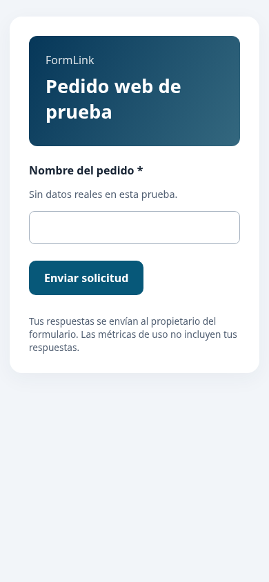

# Verificación de Fase 3 — 6 de noviembre de 2026

## Resultados locales

| Comprobación | Resultado |
|---|---|
| Kotlin debug y compilación de instrumentadas | Correctos |
| APK debug | Construido |
| Pruebas unitarias Android | **135 aprobadas**, sin errores |
| Instrumentadas Pixel_9, Android 17 / API 37 | **54 aprobadas**, 0 fallos, 0 omisiones |
| Reglas Firestore | **9 aprobadas** |
| Validación web | **5 unitarias aprobadas** |
| Navegador real Chrome, vista móvil | **2 E2E aprobadas** |
| Android Lint (`lintDebug`) | Aprobado, **0 errores**; quedan advertencias no bloqueantes |
| TypeScript y build Vite de producción | Correctos |
| Auditoría npm del cliente web | 0 vulnerabilidades tras corregir versiones y overrides |
| Workflow YAML | Parseado: Android, web/reglas e instrumentadas |
| Revisión básica de secretos en archivos e historial | Sin coincidencias en los patrones de claves privadas, cuentas de servicio y tokens GitHub revisados; valores nunca impresos |

La suite cubre migraciones históricas, exportación cifrada con conservación de registros, integridad AES-GCM, recuperación de portada interrumpida, configuración ausente/diferente, renovación de sesión, guardado pendiente, recuperación en otra base Room, aislamiento por cuenta y restauración de ediciones.

El recorrido remoto probado publica, envía sin autenticación del cliente, sincroniza a la bandeja, cambia/reabre estados y archiva sin perder snapshots. Las reglas prueban los nueve tipos con diez preguntas, párrafos multilínea, límites numéricos, propiedad, doble envío y ausencia de comprobantes. La web prueba requerido, pérdida de conexión, reintento, única respuesta y recarga posterior.

## Comandos ejecutados

```sh
./gradlew compileDebugKotlin testDebugUnitTest lintDebug assembleDebug compileDebugAndroidTestKotlin --max-workers=1 -Pkotlin.compiler.execution.strategy=in-process
./gradlew connectedDebugAndroidTest -PfirebaseEmulators=true -Pandroid.testInstrumentationRunnerArguments.backendEmulators=true --max-workers=1 -Pkotlin.compiler.execution.strategy=in-process
npm run build --prefix web
npm test --prefix web
# Con Emulator Suite iniciado en demo-formlink, desde backend-tests:
node --test rules.test.mjs
# Desde la raíz, Chrome instalado y emuladores activos:
bash scripts/test-web-browser.sh
```

Las pruebas de Firebase usaron **Emulator Suite**, no el proyecto real. Chrome se ejecutó en un perfil temporal aislado mediante Playwright. Se corrigieron los errores encontrados; no se creó una línea base para ocultar errores de Lint ni se omitieron pruebas de backend en la ejecución final.

## Evidencia visual

Captura real del navegador con un fixture aislado de pruebas; no representa un despliegue público:



## Pendientes externos

- Autenticar Firebase CLI con acceso a `formlink-9f735`, registrar/verificar la app WEB y desplegar reglas, índices y Hosting. La comprobación inicial de proyectos falló por ausencia de autenticación. No se verificó un enlace de producción.
- Demostrar persistencia en consola real y su recuperación tras iniciar sesión nuevamente.
- Confirmar eventos en DebugView, exportación diaria y fallo controlado en el panel real de Crashlytics. El código del SDK y las pruebas locales no acreditan visibilidad en esos paneles.
- Abrir los PRs y ejecutar Actions: no se dispone de sesión/API de GitHub para crearlos o comprobar sus ejecuciones. Las ramas y descripciones permiten hacerlo desde la web.
- Revisión aprobada por otro integrante, QA manual del equipo, responsables/fechas originales y feedback real de Fase 2.

No se modificó ni se integró directamente a main. Las correcciones comunes de seguridad/Lint y CI se heredaron entre ramas para que cada PR tenga sus controles.
